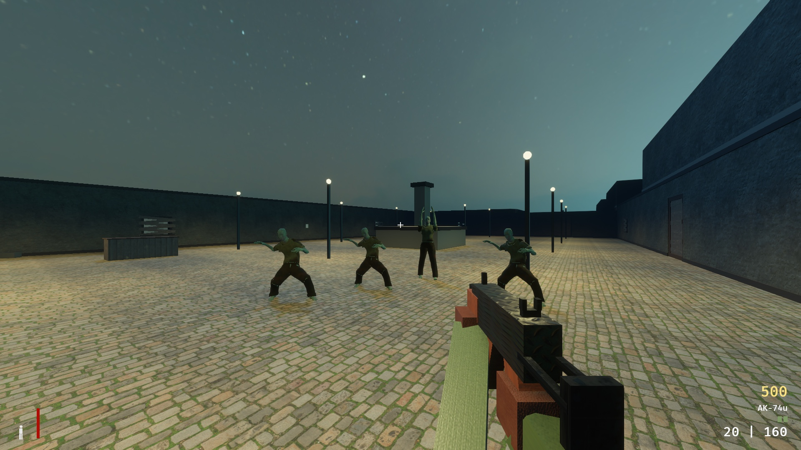
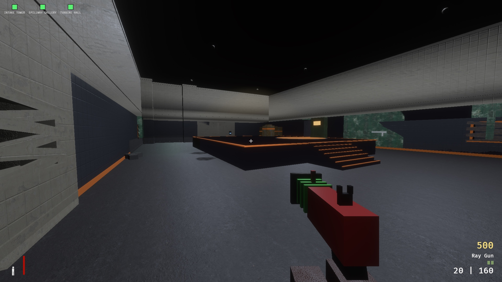
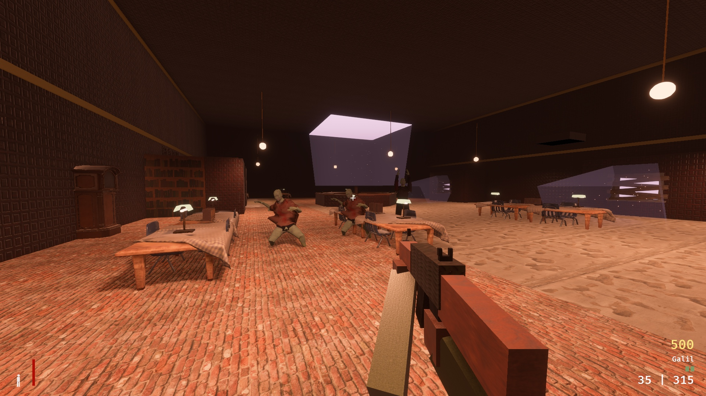
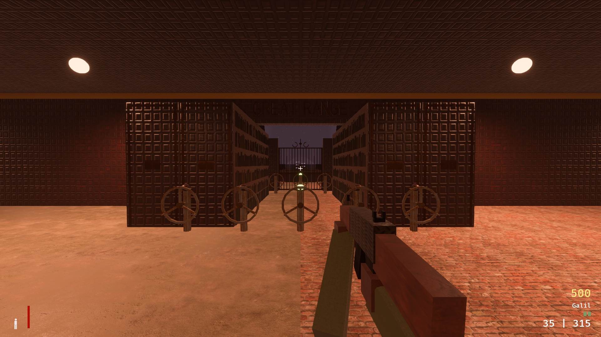
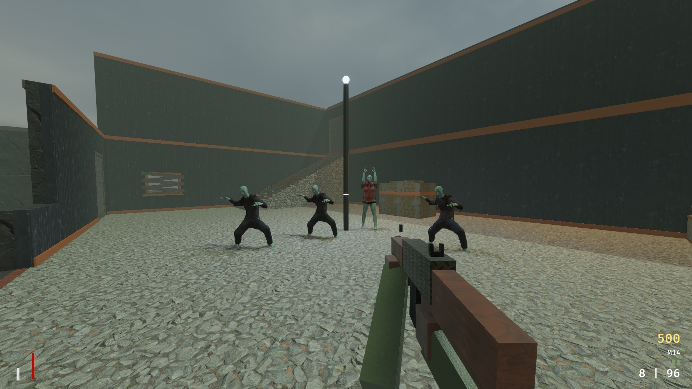
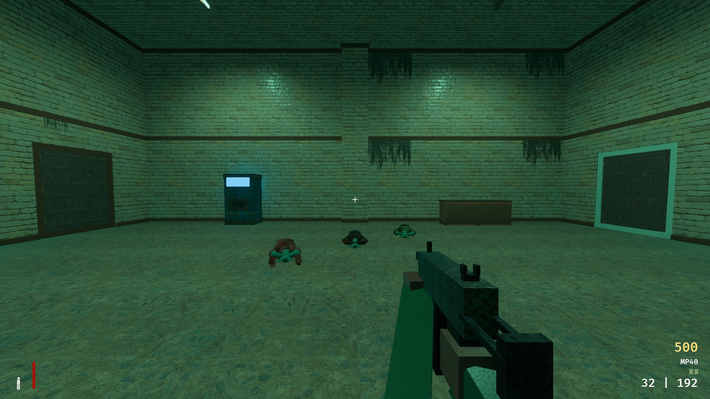
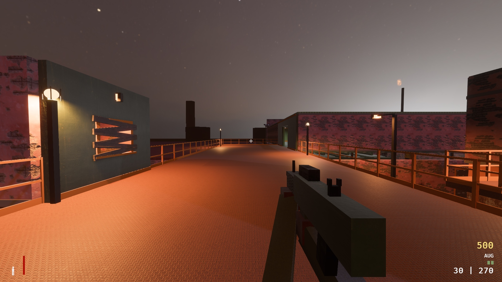
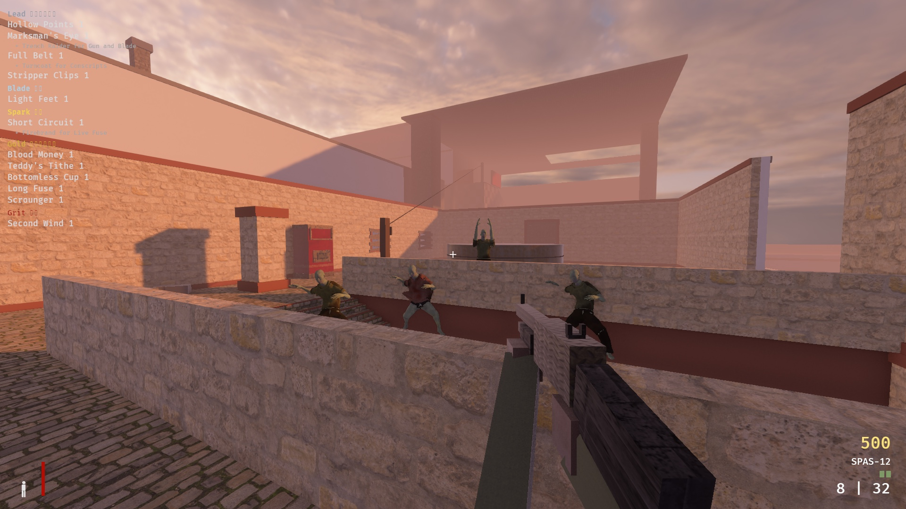
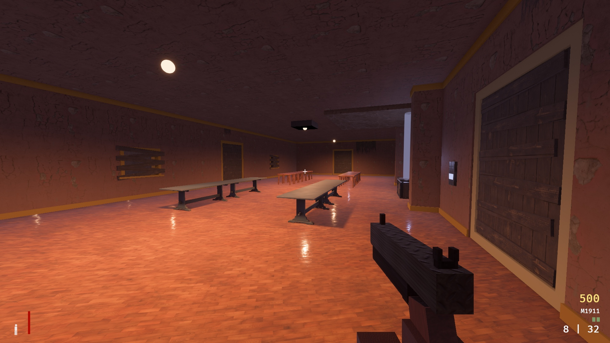
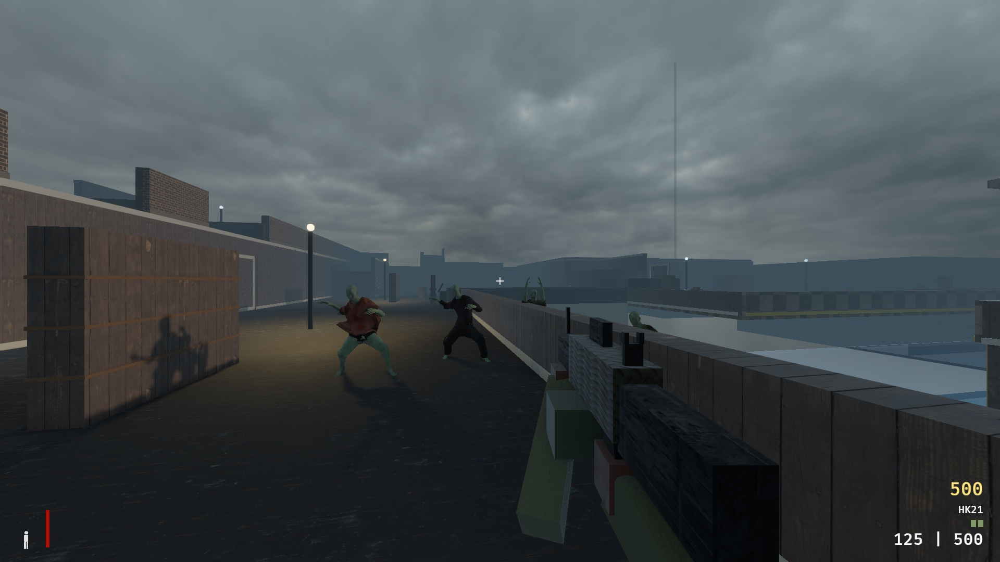

# Zombies

A single-player and Co-op first-person zombies game, inspired by the round-based zombies modes of the late 2000s. Built with [Bevy](https://bevyengine.org) and [avian3d](https://github.com/Jondolf/avian).

## Screenshots

<table>
  <tr>
    <td width="50%"><br><sub>The Village's Market at night: four Walkers shamble in, AK-74u in hand.</sub></td>
    <td width="50%"><br><sub>The Dam's Turbine Hall, empty and lit, with the Ray Gun in hand.</sub></td>
  </tr>
  <tr>
    <td width="50%"><br><sub>The Archive's Reading Room: three Zombies among the tables, Galil raised.</sub></td>
    <td width="50%"><br><sub>The Archive's Great Range, with the Wheels that turn its shifting Bookcases.</sub></td>
  </tr>
  <tr>
    <td width="50%"><br><sub>The Quarry's Rail Yard in the haze, four Walkers and an M14.</sub></td>
    <td width="50%"><br><sub>The Sanatorium's Entrance Hall: three Crawlers at floor level, MP40 in hand.</sub></td>
  </tr>
  <tr>
    <td width="50%"><br><sub>The Refinery's Pipe Bridge at night, lit by its own lamps.</sub></td>
    <td width="50%"><br><sub>A Gauntlet Run in the Cove's Piazza: Sprinters close in, the Boons held are listed top left, SPAS-12 in hand.</sub></td>
  </tr>
  <tr>
    <td width="50%"><br><sub>The Greybox's Dining Room with the starting M1911, Points and ammo bottom right.</sub></td>
    <td width="50%"><br><sub>The Polder's Harbour at dusk: four Joggers on the quay, HK21 in hand.</sub></td>
  </tr>
</table>

Every shot is the game's own output, made with the screenshot tour (`src/tour.rs`). To retake one, build with `cargo build --release`, then run only the binary with a scratch `HOME`, so no Run Record or setting lands in `~/.zombies`: for example `HOME=$(mktemp -d) BEVY_ASSET_ROOT=$PWD ZOMBIES_TOUR=village ZOMBIES_TOUR_ONLY=market ZOMBIES_TOUR_WEAPON=ak74u ZOMBIES_TOUR_ZOMBIES=4 ZOMBIES_TOUR_OUT=shots target/release/zombies` (the binary is under `target/<triple>/release/` if `CARGO_BUILD_TARGET` is set). Keep `BEVY_ASSET_ROOT` pointing at the repository: a binary run directly looks for `assets/` beside itself (`cargo run` sets this for you), and without them the game falls back to flat colours. `ZOMBIES_TOUR_MODE=gauntlet` plays a Gauntlet Run, and the header of `src/tour.rs` lists the rest (`ZOMBIES_TOUR_ZOMBIES=3:crawler` picks a kind of Zombie, `ZOMBIES_TOUR_WEAPON=raygun:upgraded` a Pack-a-Punched Weapon).

Everything pictured is the game's own CC0 assets and code, so the screenshots fall under the licence below.

## Install on Windows

Open PowerShell (no admin needed) and run:

```powershell
& ([scriptblock]::Create((irm https://github.com/jchevertonwynne/zombies/releases/latest/download/zombies.ps1))) install
```

This installs the latest release into `%LOCALAPPDATA%\Zombies` and adds Zombies to the Start Menu. Every download is checked against the SHA-256 published with the release. Windows may warn that the game is from an unknown publisher, because it isn't code-signed.

To update or uninstall, run the same line with `update` or `remove` in place of `install`. Update keeps your saves, skips the ~300 MB of assets when they haven't changed, and won't run while the game is open. Remove keeps your saves, settings and Run Records (in `%APPDATA%\zombies`) unless you add `-Purge`:

```powershell
& ([scriptblock]::Create((irm https://github.com/jchevertonwynne/zombies/releases/latest/download/zombies.ps1))) remove -Purge
```

Co-op players need the same release, so update before playing together.

## Build and run

You need a stable Rust toolchain.

```sh
cargo run --release
```

Run Records and settings are saved under `~/.zombies` (`%APPDATA%\zombies` on Windows).

## Licence

The code is dual-licensed under either of

- MIT licence ([LICENSE-MIT](LICENSE-MIT))
- Apache License, Version 2.0 ([LICENSE-APACHE](LICENSE-APACHE))

at your option.

The assets under `assets/` are CC0 (public domain). [`assets/manifest.json`](assets/manifest.json) lists the source and licence of every one.

Unless you explicitly state otherwise, any contribution you intentionally submit for inclusion in this work, as defined in the Apache-2.0 licence, is dual-licensed as above, without any additional terms or conditions.
